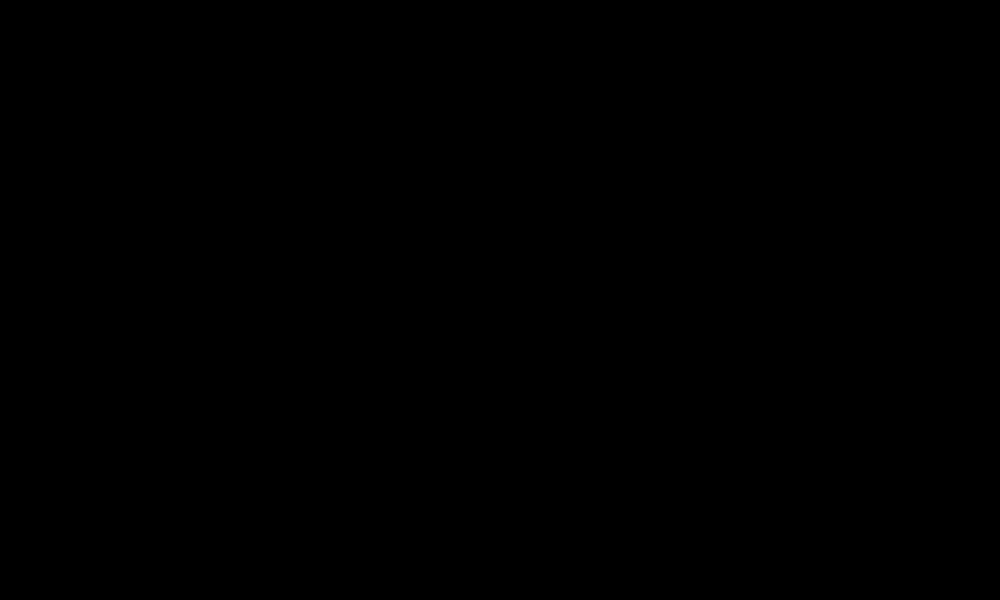
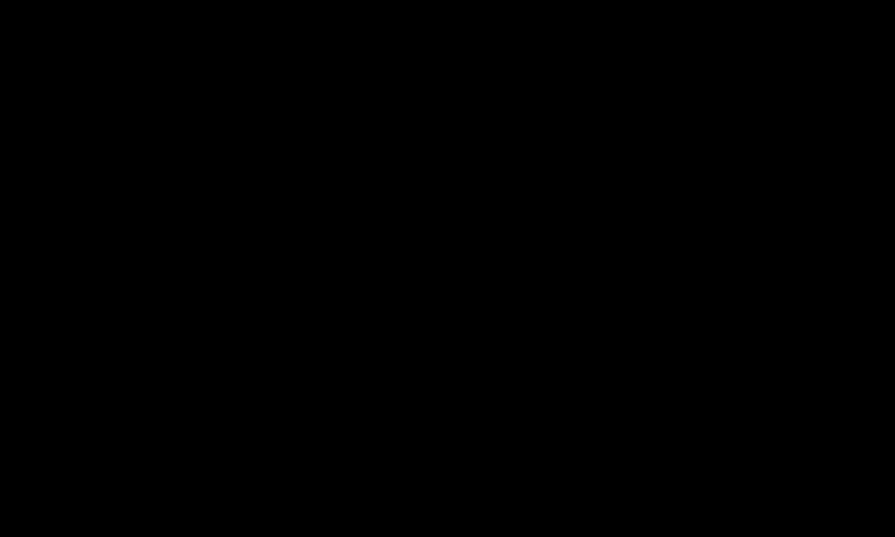
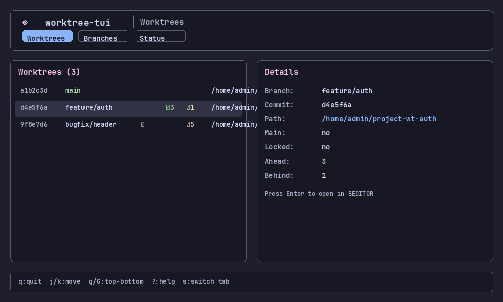

# worktree-tui

A high-performance, beautiful Terminal User Interface for managing Git worktrees, inspired by [lazygit](https://github.com/jesseduffield/lazygit).

Built with [Rust](https://rust-lang.org), [ratatui](https://github.com/ratatui/ratatui), [crossterm](https://github.com/crossterm-rs/crossterm), and [tokio](https://tokio.rs).

---

## 🖼️ Demo

<table>
  <tr>
    <td><b>Worktree list view</b></td>
    <td><b>Split view with details panel</b></td>
  </tr>
  <tr>
    <td>
      
    </td>
    <td>
      
    </td>
  </tr>
</table>

<p align="center">
  <a href="assets/demo.gif">
    
  </a>
  <br/>
  <em>Click above to view the full demo recording</em>
</p>


---

## 🚀 Features

| Feature | Status |
|---------|--------|
| Interactive worktree browser | ✅ |
| Split-pane layout (list + details panel) | ✅ |
| Catppuccin Mocha theme | ✅ |
| TOML-configurable keybindings | ✅ |
| Async Git operations (non-blocking UI) | ✅ |
| Responsive terminal resize | ✅ |
| Mouse support (click to select, scroll) | ✅ |
| Multi-tab navigation (Worktrees / Branches / Status) | ✅ |
| Git worktree list (`git worktree list --porcelain`) | ✅ |
| Git worktree remove (`git worktree remove`) | ✅ |
| Git worktree add (manual + refresh) | ✅ |
| Branch browser tab | 🚧 |
| Git status tab | 🚧 |
| Custom themes | 🚧 |
| Config hot-reload | 🚧 |
| Plugin system | 📋 |
| SSH/Git host integration | 📋 |

### Implemented keybindings

| Key | Action |
|-----|--------|
| `q` / `Q` | Quit / force quit |
| `j` / `k` | Move down / up |
| `h` / `l` | Move focus left / right |
| `J` / `K` | Page down / up |
| `g` / `G` | Go to top / bottom |
| `Enter` | Select worktree |
| `Space` | Toggle selection |
| `a` | Add new worktree (placeholder) |
| `d` | Remove selected worktree |
| `r` | Refresh worktree list from git |
| `s` | Switch tab |
| `?` | Toggle help overlay |
| `Esc` | Back / cancel |
| Mouse click | Select worktree in list |
| Mouse scroll | Scroll worktree list |

### Example config

Configuration lives at `~/.config/worktree-tui/config.toml`. A default is generated on first launch:

```toml
[[keybindings]]
key = "q"
action = "quit"

[[keybindings]]
key = "j"
action = "move_down"

# ... more bindings

[theme]
base = "#1e1e2e"
surface = "#181825"
border = "#585b70"
text = "#cdd6f4"
muted = "#a6adc8"
highlight = "#cba6f7"
selected = "#313244"
active = "#89b4fa"
success = "#a6e3a1"
warning = "#f9e2af"
error = "#f38ba8"
title = "#f5c2e7"
```

---

## 📦 Installation

### From source

```bash
git clone https://github.com/hakuxyz/worktree-tui.git
cd worktree-tui
cargo build --release
./target/release/worktree-tui
```

### Using cargo install

```bash
cargo install --git https://github.com/hakuxyz/worktree-tui.git
```

### Requirements

- Rust 1.70+
- A terminal with 256-color support

---

## ⌨️ Keybindings

Keybindings are fully customizable via `~/.config/worktree-tui/config.toml`.

| Key | Action |
|-----|--------|
| `q` | Quit |
| `Q` | Force quit |
| `j` / `k` | Move down / up |
| `h` / `l` | Move left / right (panel focus) |
| `J` / `K` | Page down / up |
| `g` / `G` | Go to top / bottom |
| `Enter` | Select worktree |
| `Space` | Toggle selection |
| `a` | Add new worktree |
| `d` | Remove worktree |
| `r` | Refresh worktree list |
| `s` | Switch tab |
| `?` | Toggle help overlay |
| `Esc` | Back / cancel |

### Custom keybindings with modifiers

```toml
[[keybindings]]
key = "c"
modifiers = ["Control"]
action = "copy_path"

[[keybindings]]
key = "s"
modifiers = ["Shift"]
action = "save_session"
```

---

## ⚙️ Configuration

Configuration lives at `~/.config/worktree-tui/config.toml`. A default config is generated on first launch.

### Theme configuration

The default theme is **Catppuccin Mocha**. Customize colors in the `[theme]` section:

```toml
[theme]
base = "#1e1e2e"      # Background
surface = "#181825"   # Panel background
border = "#585b70"    # Borders
text = "#cdd6f4"      # Primary text
muted = "#a6adc8"     # Secondary text
highlight = "#cba6f7" # Highlighted text
selected = "#313244"  # Selected row background
active = "#89b4fa"    # Active tab / element
success = "#a6e3a1"   # Success messages
warning = "#f9e2af"   # Warning messages
error = "#f38ba8"     # Error messages
title = "#f5c2e7"     # Titles and headers
```

### Theme showcase

| Element | Color (Catppuccin Mocha) |
|---------|--------------------------|
| Base / background | `#1e1e2e` |
| Surface / panel | `#181825` |
| Border | `#585b70` |
| Text | `#cdd6f4` |
| Muted | `#a6adc8` |
| Highlight | `#cba6f7` |
| Selected | `#313244` |
| Active | `#89b4fa` |
| Success | `#a6e3a1` |
| Warning | `#f9e2af` |
| Error | `#f38ba8` |
| Title | `#f5c2e7` |

---

## 🏗️ Project Structure

```
worktree-tui/
├── Cargo.toml              # Manifest & dependencies
├── config.toml             # Example user config
├── README.md               # This file
├── src/
│   ├── main.rs             # Entry point & logging
│   ├── app.rs              # Application state, Worktree model, InputHandler
│   ├── config.rs           # TOML config loading/saving, KeyBinding
│   ├── event.rs            # Async event loop (tokio + crossterm + mpsc)
│   ├── git.rs              # Async git CLI wrapper
│   ├── theme.rs            # Catppuccin palette & Theme struct
│   └── ui.rs               # ratatui layout & widget rendering
└── assets/
    ├── screenshots/
    └── demo.gif
```

### Core modules

| Module | Responsibility |
|--------|----------------|
| `src/main.rs` | Entry point, logging init, wires app + event loop |
| `src/app.rs` | `App` state, `Worktree` model, `Tab` enum, `Action` enum, `InputHandler` |
| `src/config.rs` | `Config` (keybindings + theme), TOML serialize/deserialize, config path resolution |
| `src/event.rs` | `EventLoop` — async event loop, mpsc channel, terminal setup/teardown |
| `src/git.rs` | Async `git` CLI wrapper (worktree list/add/remove/branch/status) |
| `src/theme.rs` | `Theme` struct, Catppuccin Mocha `palette` constants |
| `src/ui.rs` | `draw()` — header, body (split list + preview), footer rendering |

---

## 🧠 Architecture

### Event loop

The UI runs on a dedicated tokio task. Crossterm events (key, mouse, resize) are read on a blocking thread and forwarded via an `mpsc` channel to the main async loop. This guarantees the UI never freezes during Git operations.

```
┌─────────────────┐     mpsc channel     ┌─────────────────┐
│  Input task     │ ──────────────────>  │  Main loop      │
│ (crossterm read)│   AppEvent           │ (render + state)│
└─────────────────┘                      └─────────────────┘
         │                                       │
         ▼                                       ▼
   Key/mouse/resize                         ratatui::Terminal.draw()
```

### State management

`App` is the single source of truth. `InputHandler` translates key events into `Action` variants using the user's TOML config, then applies them to `App`. Git operations run as background tokio tasks and signal completion via channels.

---

## 🗺️ Roadmap

- [x] Project scaffolding (Cargo.toml, module layout)
- [x] Core event loop (tokio + crossterm + ratatui)
- [x] Catppuccin theme & responsive layout
- [x] TOML keybinding configuration
- [x] Worktree list + details panels
- [x] Git worktree list (`git worktree list --porcelain`)
- [x] Git worktree remove (`git worktree remove`)
- [x] Git worktree add (placeholder + refresh)
- [x] Mouse support (click to select, scroll)
- [ ] Branch browser tab
- [ ] Git status tab
- [ ] Custom theme support (load from config)
- [ ] Config validation & hot-reload
- [ ] Plugin system for custom commands
- [ ] SSH remote integration
- [ ] CI/CD pipeline (GitHub Actions)
- [ ] Crates.io publication

---

## 🤝 Contributing

Contributions are welcome! Please open an issue or pull request.

```bash
# Fork the repo, then:
git clone https://github.com/hakuxyz/worktree-tui.git
cd worktree-tui
cargo fmt
cargo clippy
cargo test
```

---

## 📄 License

MIT License. See [LICENSE](LICENSE) for details.

---

## 🙏 Acknowledgments

- [lazygit](https://github.com/jesseduffield/lazygit) — inspiration
- [ratatui](https://github.com/ratatui/ratatui) — TUI framework
- [Catppuccin](https://github.com/catppuccin/catppuccin) — color palette
- [crossterm](https://github.com/crossterm-rs/crossterm) — terminal handling
